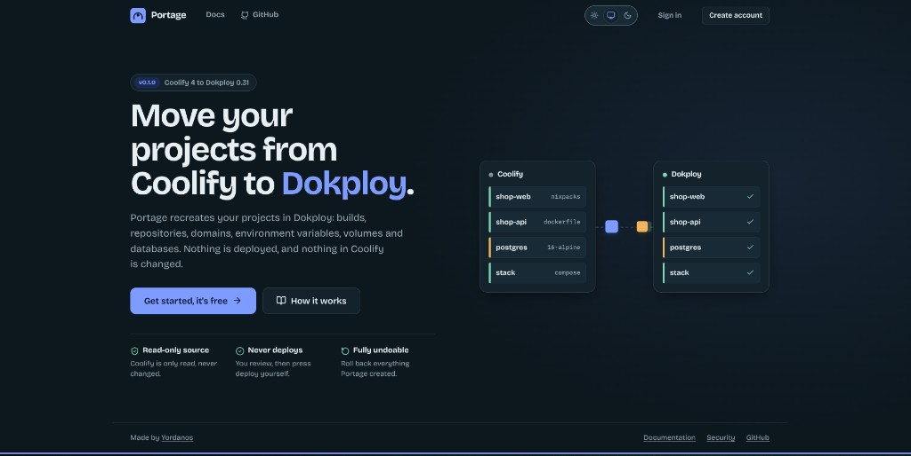

# Portage

[](https://portage.launchpad.et)

Move your projects from **Coolify** to **Dokploy**.

**Live:** [portage.ethiodeploy.app]([https://portage.ethiodeploy.app]) · **Source:** [github.com/j-ordanos/portage](https://github.com/j-ordanos/portage)

Portage recreates your Coolify projects in Dokploy: build types, Git repositories, Docker Compose files, domains, environment variables, volumes and databases. You review the exact plan first, nothing is deployed, nothing in Coolify is changed, and everything it creates can be rolled back.

There is no official migration path between the two platforms. Portage automates the part that is otherwise hours of clicking and copying.

## What it does

- **Reads Coolify** through its API (read-only) and shows every project, environment, app, database and service.
- **Plans** the Dokploy equivalent of each one, with the Coolify name next to the Dokploy name.
- **Links private repositories** by checking which Dokploy GitHub App can actually reach each repo, or by matching the same SSH key by fingerprint. App names do not need to match.
- **Creates** projects, apps, compose stacks and databases in Dokploy, undeployed, with live progress. You can pause, retry or skip a step.
- **Verifies** by reading everything back, and gives you a report with the manual to-do list.
- **Rolls back** only what it created, after you type a confirmation phrase.
- **Keeps your tokens safe.** Saved server tokens are encrypted and can never be read back, only replaced.

It does not copy data (database contents, volume files) or deployment history. The report contains dump and restore commands.

## Run it on Dokploy

1. Create an **Application** in Dokploy from this repository.
2. Build type: **Dockerfile**.
3. Add a **volume mount** at `/data`.
4. Add a domain with HTTPS to container port `3000` (for example `portage.launchpad.et`), and deploy.
5. Open the site and create your account. The first account is always allowed.

No environment variables are required. See the table below to harden it.

### Settings

| Variable | Default | Purpose |
|---|---|---|
| `PORT` | `3000` | Port to listen on. |
| `DATA_DIR` | `./data` (`/data` in the image) | Database and generated key. Keep it on a volume. |
| `MASTER_KEY` | generated | Optional. 32 bytes, base64 (`openssl rand -base64 32`). Seals saved tokens. If unset, a key is generated into `DATA_DIR/master.key`. Setting it yourself is stronger, because the key then lives apart from the data. |
| `ALLOW_SIGNUP` | `true` | Set `false` to stop others creating accounts once yours exists. |
| `UPSTREAM_ALLOW_PRIVATE` | `true` | Allow Coolify/Dokploy on private addresses. Set `false` on a public instance. |
| `UPSTREAM_ALLOWED_HOSTS` | none | Optional comma-separated allow-list of hosts. |
| `PUBLIC_URL` | none | Your public `https://` address, for example `https://portage.launchpad.et`. Enables secure cookies and HSTS. |

Back up `DATA_DIR` **together with the key**. Without it, saved tokens cannot be decrypted and must be added again.

## Tested with

| | Version |
|---|---|
| Coolify | 4.7.5 |
| Dokploy | v0.31.4 |

Other 4.x and 0.3x versions usually work and show a warning when something differs.

## Develop

Requires Node 22 and pnpm 10 (`mise install` picks them up).

```bash
pnpm install
pnpm dev          # http://localhost:3001
pnpm lint && pnpm typecheck && pnpm test && pnpm build
```

Layout: `packages/core` (extract, plan, apply, verify, rollback), `apps/server` (API, accounts, SQLite), `apps/web` (the interface), `apps/cli`.

## Security

See [SECURITY.md](SECURITY.md).

## License

MIT. Made by [Yordanos](https://github.com/j-ordanos).
